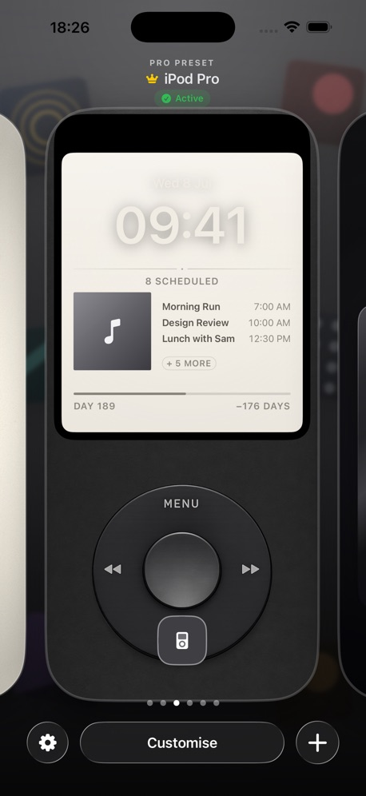
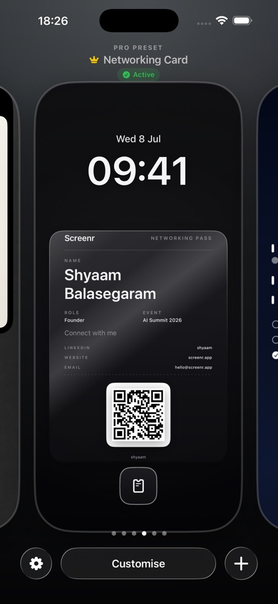
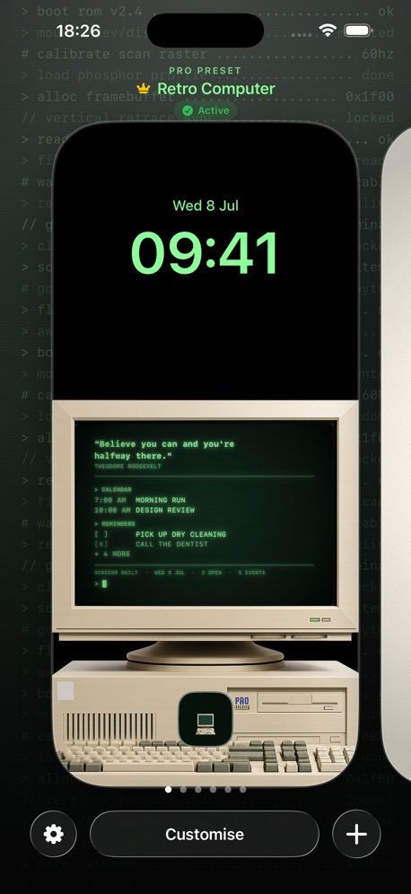

# Screenr

An iPhone app for designing your Lock Screen. **[Download on the App Store](https://apps.apple.com/gb/app/screenr/id6787151161)**

  
  
  

> The source code is private. This page describes the product.

## What it does

- **Lock Screen editor.** Build a wallpaper from quotes, reminders, calendar events and progress trackers.
- **Presets.** Designs such as an iPod, a networking card with a QR code, and a retro computer.
- **Export.** Save the result as a high-resolution wallpaper.
- **Screenr Pro.** A paid tier with more presets, fonts and effects.

## How it was built

SwiftUI, with subscriptions through RevenueCat. I built it almost entirely with AI coding tools. My work was the product design, the testing, and getting it through App Store review.
